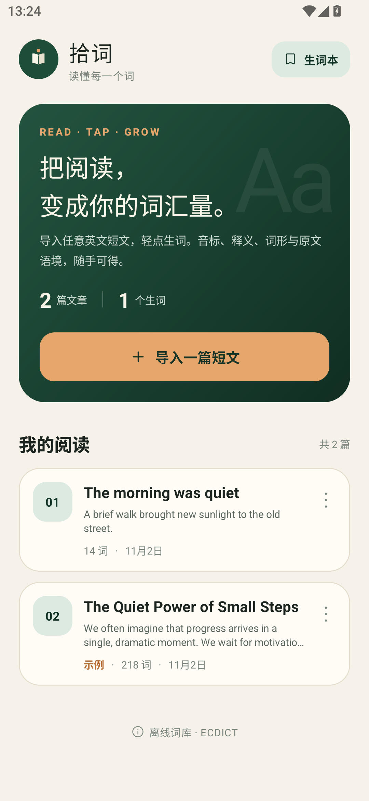
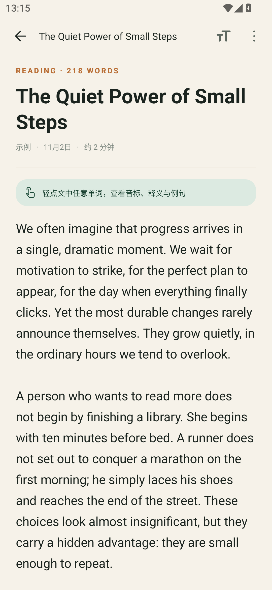
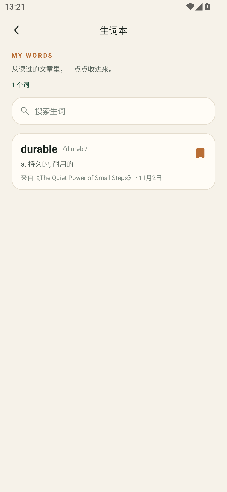
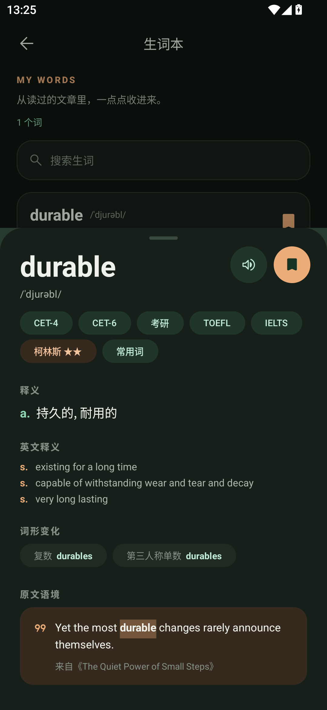

# 拾词 · ShiCi

GitHub 仓库：<https://github.com/ydqf297/shici>

一个离线优先的 Android 英文精读应用：导入英语短文，轻点任意单词，就能看到音标、中文释义、英文释义、词形变化、考试标签和原文语境，还能发音并收藏到生词本。

## 功能

- **导入短文**：手动输入、从剪贴板粘贴、读取 `.txt` 文件，或使用内置示例。
- **点词即查**：文章中的每个英文单词都可点击；支持 `don't`、`well-known` 以及带重音的单词。
- **离线词典**：内置约 40 万条单词，首次查词时展开到应用私有目录，之后完全离线。
- **词条详情**：中英文释义、音标、词形变化、考试标签、柯林斯/牛津标记、词频、原文语境。
- **设备发音**：调用系统英文 TTS 朗读单词。
- **生词本**：收藏/取消收藏，搜索，按来源查看，随时回到原文语境。
- **阅读体验**：四档字号、深色模式、阅读提示、长文滚动。
- **隐私**：没有网络权限，短文和生词只存放在本机。
- 首次启动自带一篇示例短文，删除后也可以从空书架重新导入。

## 界面

| 书架 | 精读 |
| --- | --- |
|  |  |

| 点词详情 | 生词本 |
| --- | --- |
|  |  |

深色模式：



## 使用

1. 安装 APK，打开「拾词」。
2. 点「导入一篇短文」，输入/粘贴英文，或从 `.txt`、剪贴板导入。
3. 进入阅读页，轻点任意英文单词。
4. 在词条面板里听发音、看释义和原文语境；点右上角书签收藏。
5. 在首页右上角进入「生词本」，可以搜索、回看或移除单词。

## 直接安装

推荐从 [GitHub Releases](https://github.com/ydqf297/shici/releases/latest) 下载 APK，也可以直接下载仓库中的 [dist/ShiCi-1.0.0.apk](dist/ShiCi-1.0.0.apk)。校验值见 `dist/SHA256SUMS.txt`。

`dist/ShiCi-1.0.0.apk` 是由开发者本地签名密钥签名的 release 包，可直接侧载安装。为了安全，签名私钥和 `keystore.properties` 没有上传到仓库。若你自行构建并希望覆盖升级这个版本，请使用同一签名密钥；否则 Gradle 会回退到 debug 签名，需要先卸载旧版再安装。

已在 Android 15（MuMu 模拟器）上实际安装并验证：导入 / 点词查看详情 / 收藏 / 生词本搜索 / 深色模式 / 删除均正常。首次点词时会把约 42 MB 的离线词典展开到应用私有目录，通常只需要很短的等待。

## 构建

环境要求：

- JDK 17
- Android SDK Platform 35、Build-Tools 35.0.0
- 已接受的 Android SDK 许可证

先在项目根目录创建你本机的 `local.properties`（已在 `.gitignore` 中排除），指向 Android SDK，例如：

```properties
# Windows
sdk.dir=D\:\\Android\\Sdk
# macOS / Linux
# sdk.dir=/path/to/Android/Sdk
```

构建：

```bash
./gradlew assembleRelease
```

APK 输出于：

```
app/build/outputs/apk/release/app-release.apk
```

> 首次构建会从 Google Maven / Maven Central 下载依赖。安装包约 22 MB，其中离线词典压缩后约占 18 MB。

## 词库

- 词条数据来自 [ECDICT](https://github.com/skywind3000/ECDICT)（MIT License），英文释义源自 WordNet 等公开数据。
- 本项目保留 401,816 条单单词词条；短语、专有组合词不参与点词查询。
- 数据库位于 `app/src/main/assets/dictionary.db`，首次查词时复制到 `files/dictionary_v1.db`。复制与查询都在后台线程执行。
- 词库构建脚本：

```bash
python tools/build_dictionary.py
```

脚本默认使用 ECDICT 官方 CSV；如本地没有，会自动下载。可通过 `--csv` 指定已有的 CSV。

### 点词与词形

- 点到的词会先做大小写、弯引号和前后标点归一化。
- 精确词条不存在时，会尝试所有格、常见复数/过去式/现在分词/比较级还原，以及去掉重音符号（`café → cafe`）。
- 词库中的 `exchange` 字段用于展示词形变化。

## 数据结构

应用自己的数据库为 `data/data/com.shici.reader/databases/shici.db`：

- `articles`：文章标题、正文、创建时间、是否示例。
- `saved_words`：收藏的单词、音标、释义、原文语境、来源文章和收藏时间。

## 目录

```
app/src/main/java/com/shici/reader/
  MainActivity.java          书架
  ImportActivity.java        导入与编辑
  ReaderActivity.java        点词精读
  WordbookActivity.java      生词本
  ui/WordDetailSheet.java    单词详情底部面板
  data/DictionaryRepository.java
  data/AppDatabase.java
  util/WordUtils.java        分词、语境、词形还原
  util/WordFormatting.java   词条排版
app/src/main/assets/
  dictionary.db
  ECDICT-LICENSE.txt
tools/build_dictionary.py
```

## 已知说明

- 语音取决于设备是否安装了英文 TTS 引擎；没有引擎时会给出提示，不影响查词和阅读。
- 导入文件支持 UTF-8、UTF-16（带 BOM）以及 GB18030 回退，文件大小限制为 1 MB；单篇正文建议控制在 8 万字符以内。
- 这是为你直接使用而构建的应用，未接入账号、云同步或在线词典。
