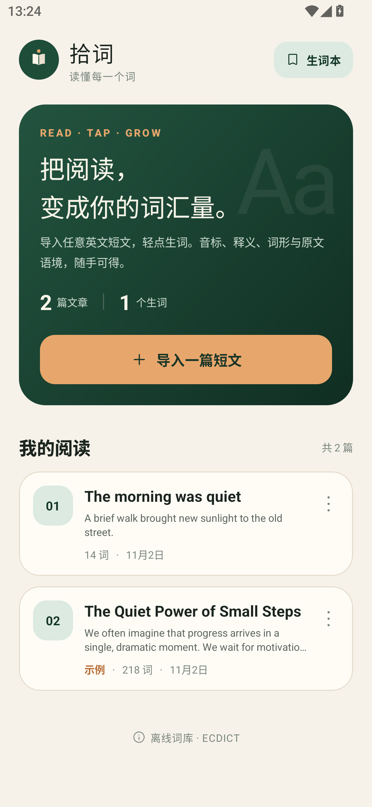
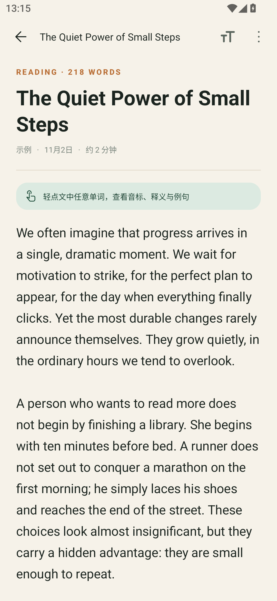
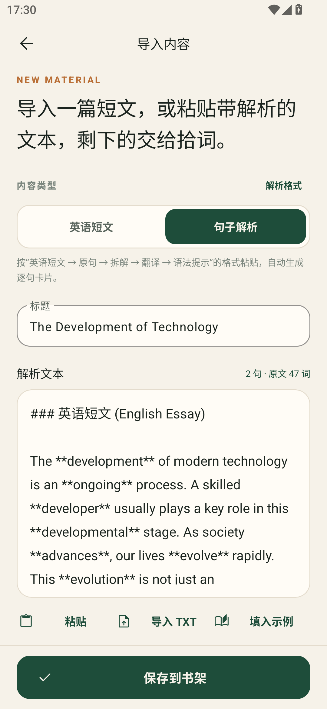
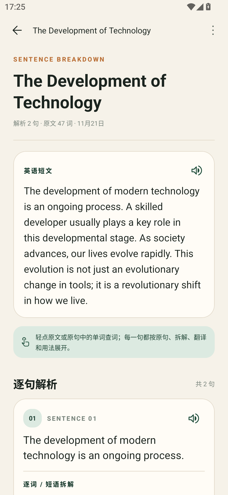
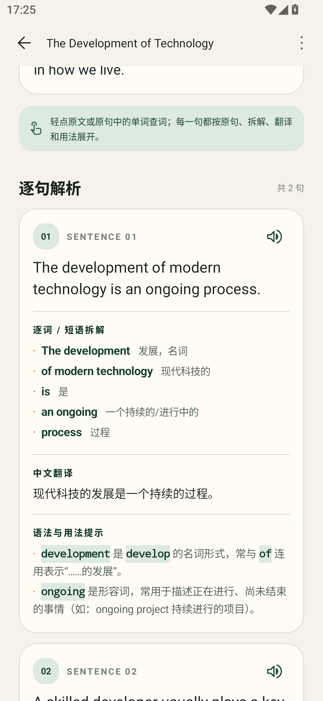
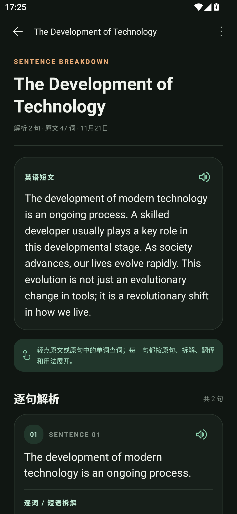
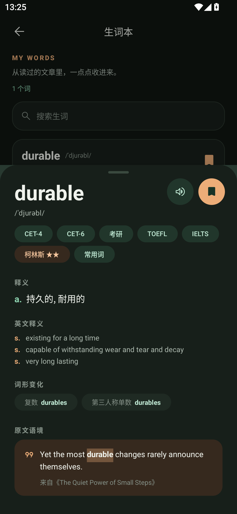

# 拾词 · ShiCi

GitHub 仓库：<https://github.com/ydqf297/shici>

一个离线优先的 Android 英文精读应用：导入英语短文，轻点任意单词，就能看到音标、中文释义、英文释义、词形变化、考试标签和原文语境；还可以导入「英语短文 + 逐句解析」文本，自动生成「原句 → 逐词/短语拆解 → 中文翻译 → 语法与用法提示」的解析卡片。

## 功能

- **导入短文**：手动输入、从剪贴板粘贴、读取 `.txt` 文件，或使用内置示例。
- **句子解析**：在导入页选择「句子解析」，粘贴带解析的文本，自动整理成逐句卡片；原句和原文中的单词都可以点按查词。
- **点词即查**：文章中的每个英文单词都可点击；支持 `don't`、`well-known` 以及带重音的单词。
- **离线词典**：内置约 40 万条单词，首次查词时展开到应用私有目录，之后完全离线。
- **词条详情**：中英文释义、音标、词形变化、考试标签、柯林斯/牛津标记、词频、原文语境。
- **设备发音**：调用系统英文 TTS 朗读单词、原文或单独一句解析。
- **生词本**：收藏/取消收藏，搜索，按来源查看，随时回到原文语境。
- **阅读体验**：四档字号、深色模式、阅读提示、长文滚动；句子解析页同样适配深色模式。
- **隐私**：没有网络权限，短文、解析和生词只存放在本机。
- 首次启动自带一篇示例短文，删除后也可以从空书架重新导入。

## 界面

| 书架 | 精读 |
| --- | --- |
|  |  |

| 点词详情 | 生词本 |
| --- | --- |
|  |  |

句子解析：

| 导入解析文本 | 解析总览 |
| --- | --- |
|  |  |

| 逐句拆解 | 深色模式 |
| --- | --- |
|  |  |

深色模式的单词详情：



## 句子解析格式

在「导入内容」页把类型切换为「句子解析」，直接粘贴下面的结构即可。标题、英文原文和逐句解析之间用 Markdown 标题分隔：

```markdown
### 英语短文

The **development** of modern technology is an ongoing process. A skilled
developer usually plays a key role in this developmental stage.

### 解析

#### 1. The development of modern technology is an ongoing process.
* **逐词/短语拆解**：
    * The development (发展，名词)
    * of modern technology (现代科技的)
    * is (是)
    * an ongoing (一个持续的/进行中的)
    * process (过程).
* **中文翻译**：现代科技的发展是一个持续的过程。
* **语法与用法提示**：
    * `development` 是 `develop` 的名词形式，常与 `of` 连用表示“……的发展”。
    * `ongoing` 是形容词，常用于描述正在进行、尚未结束的事情。

#### 2. A skilled developer usually plays a key role in this developmental stage.
* **逐词/短语拆解**：
    * A skilled developer (一位熟练的开发者)
    * usually (通常)
    * plays a key role (起关键作用)
    * in this developmental stage (在这个发展阶段).
* **中文翻译**：一位熟练的开发者通常在这个发展阶段起着关键作用。
* **语法与用法提示**：
    * `developer` 指“开发者”，由 `develop` + `-er` 后缀构成。
    * `play a key role in...` 是四级高频短语。
```

解析规则：

- `### 英语短文` 和 `### 解析` 是分段标题，也可以使用 `英文短文`、`English Essay`、`Breakdown` 等英文/中文变体。
- 每句用 `#### 1. 原句` 开头，编号用于排序。
- 每句下面可以有「逐词/短语拆解」「中文翻译」「语法与用法提示」三项中的任意几项，缺少的部分会自动隐藏。
- 拆解行推荐写成 `英文片段（中文释义）`；也接受 `英文片段 — 中文释义`。
- 解析文本中的 `` `反引号` ``、`**粗体**` 会被渲染成重点样式。
- 在导入页点右上角「解析格式」可以查看格式，并一键填入示例。

## 使用

1. 安装 APK，打开「拾词」。
2. 点「导入一篇短文」，选择「英语短文」或「句子解析」。
3. 输入/粘贴英文，或从 `.txt`、剪贴板导入。粘贴或读取到解析文本时，应用会自动切换到「句子解析」。
4. 保存到书架。普通短文进入精读页；句子解析进入「SENTENCE BREAKDOWN」页。
5. 在任何英文原文或原句中轻点单词，查看词条、发音并收藏。
6. 在首页右上角进入「生词本」，可以搜索、回看或移除单词。

## 直接安装

推荐从 [GitHub Releases](https://github.com/ydqf297/shici/releases/latest) 下载 APK，也可以直接下载仓库中的 [dist/ShiCi-1.1.0.apk](dist/ShiCi-1.1.0.apk)。校验值见 `dist/SHA256SUMS.txt`。

```text
6610e2ae363431b08f530a8cc64eef3d4839b669e5ce29ef364d6f2dec05dfda  ShiCi-1.1.0.apk
```

`dist/ShiCi-1.1.0.apk` 是由开发者本地签名密钥签名的 release 包，可直接侧载安装。为了安全，签名私钥和 `keystore.properties` 没有上传到仓库。若你自行构建并希望覆盖升级这个版本，请使用同一签名密钥；否则 Gradle 会回退到 debug 签名，需要先卸载旧版再安装。

已在 Android 15（MuMu 模拟器）上实际安装并验证：导入 / 点词查看详情 / 收藏 / 生词本搜索 / 深色模式 / 删除均正常；并验证了从 1.0.0 升级到 1.1.0 后旧文章仍能打开。首次点词时会把约 42 MB 的离线词典展开到应用私有目录，通常只需要很短的等待。

## 构建

环境要求：

- JDK 17
- Android SDK Platform 35、Build-Tools 35.0.0
- 已接受的 Android SDK 许可证

先在项目根目录创建你本机的 `local.properties`（已在 `.gitignore` 中排除），指向 Android SDK，例如：

```properties
# Windows
sdk.dir=D\:\\Android\\Sdk
# macOS / Linux
# sdk.dir=/path/to/Android/Sdk
```

构建：

```bash
./gradlew assembleRelease
```

APK 输出于：

```
app/build/outputs/apk/release/app-release.apk
```

> 首次构建会从 Google Maven / Maven Central 下载依赖。安装包约 22 MB，其中离线词典压缩后约占 18 MB。

## 词库

- 词条数据来自 [ECDICT](https://github.com/skywind3000/ECDICT)（MIT License），英文释义源自 WordNet 等公开数据。
- 本项目保留 401,816 条单单词词条；短语、专有组合词不参与点词查询。
- 数据库位于 `app/src/main/assets/dictionary.db`，首次查词时复制到 `files/dictionary_v1.db`。复制与查询都在后台线程执行。
- 词库构建脚本：

```bash
python tools/build_dictionary.py
```

脚本默认使用 ECDICT 官方 CSV；如本地没有，会自动下载。可通过 `--csv` 指定已有的 CSV。

### 点词与词形

- 点到的词会先做大小写、弯引号和前后标点归一化。
- 精确词条不存在时，会尝试所有格、常见复数/过去式/现在分词/比较级还原，以及去掉重音符号（`café → cafe`）。
- 词库中的 `exchange` 字段用于展示词形变化。

## 数据结构

应用自己的数据库为 `data/data/com.shici.reader/databases/shici.db`，当前为版本 2：

- `articles`：文章标题、原始正文、创建时间、是否示例、内容类型 `kind`、抽出的英文原文 `source_text`、原文词数 `word_count`。
  - `kind = 0`：普通英语短文，进入精读页。
  - `kind = 1`：句子解析，进入逐句解析页。
  - `body` 保留导入的原始 Markdown 文本；书架预览使用 `source_text`。
- `saved_words`：收藏的单词、音标、释义、原文语境、来源文章和收藏时间。

1.0.0 → 1.1.0 会自动执行数据库迁移，为旧文章补齐新字段；旧文章仍按普通短文打开。

## 目录

```
app/src/main/java/com/shici/reader/
  MainActivity.java             书架
  ImportActivity.java           导入短文 / 句子解析
  ReaderActivity.java           点词精读
  AnalysisActivity.java         逐句解析页
  WordbookActivity.java         生词本
  analysis/AnalysisParser.java  解析文本的本地解析器
  analysis/AnalysisDocument.java
  analysis/SentenceAnalysis.java
  ui/WordDetailSheet.java       单词详情底部面板
  data/DictionaryRepository.java
  data/AppDatabase.java
  util/WordUtils.java           分词、语境、词形还原
  util/InlineMarkdown.java      解析卡片里的行内 Markdown 样式
  util/WordFormatting.java      词条排版
app/src/main/assets/
  dictionary.db
  ECDICT-LICENSE.txt
tools/build_dictionary.py
```

## 更新日志

### 1.1.0

- 新增「句子解析」内容类型：导入带逐句解析的文本，自动生成逐句卡片。
- 解析卡片按「原句 → 逐词/短语拆解 → 中文翻译 → 语法与用法提示」展示。
- 原文和原句都支持点词查词；每条解析支持单独朗读。
- 导入页支持自动识别解析文本、格式示例、解析状态预览。
- 书架增加「句子解析」标识与对应入口；深色模式适配。
- 数据库升级到版本 2，兼容 1.0.0 的文章数据。

## 已知说明

- 句子解析是本地、格式驱动的整理，不会调用 AI 或在线翻译；中文翻译和语法提示来自你导入的文本。
- 解析文本至少需要一段英文原文和一句带编号的解析；格式不完整时会提示检查。
- 语音取决于设备是否安装了英文 TTS 引擎；没有引擎时会给出提示，不影响查词和阅读。
- 导入文件支持 UTF-8、UTF-16（带 BOM）以及 GB18030 回退，文件大小限制为 1 MB；单篇正文建议控制在 8 万字符以内。
- 这是为你直接使用而构建的应用，未接入账号、云同步或在线词典。
